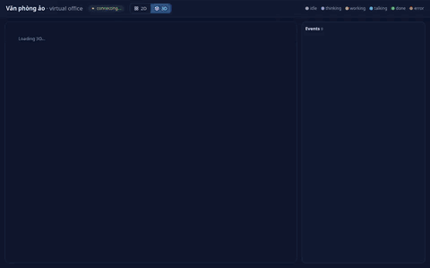
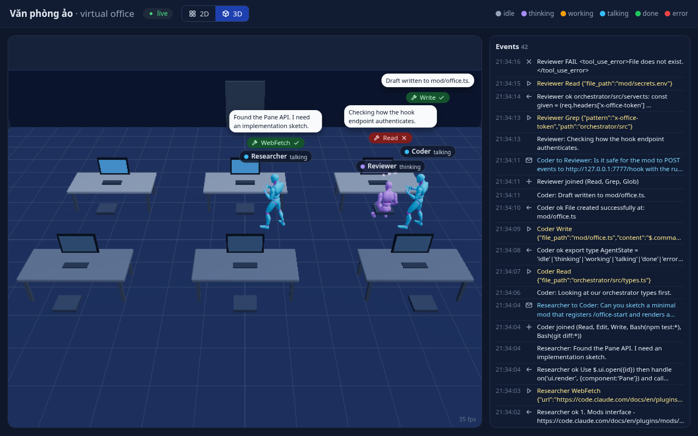
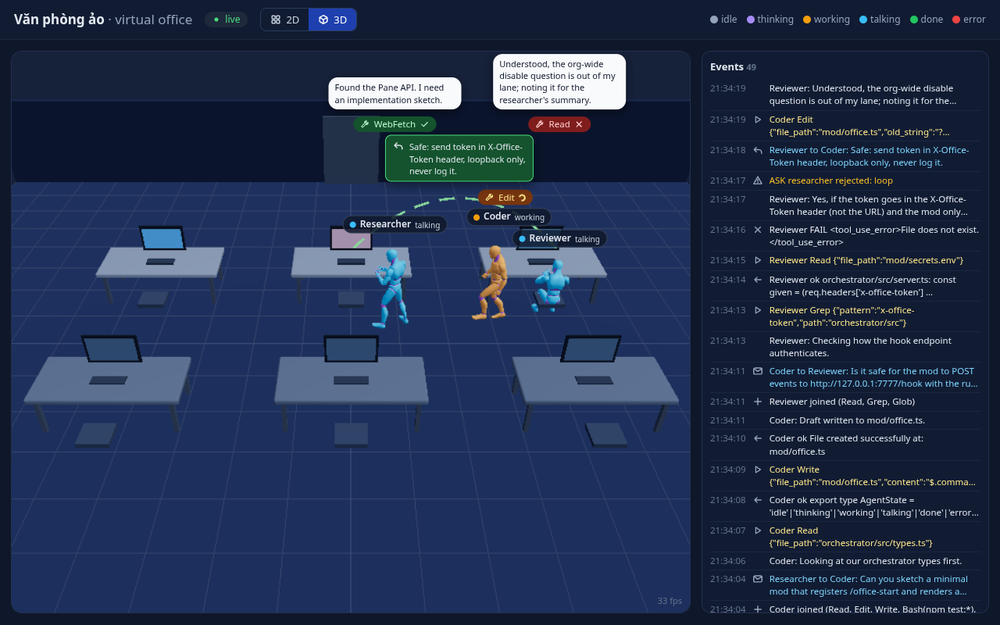
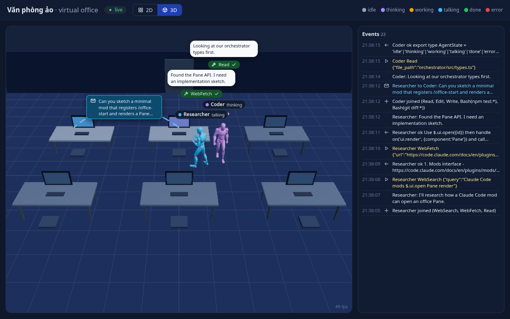
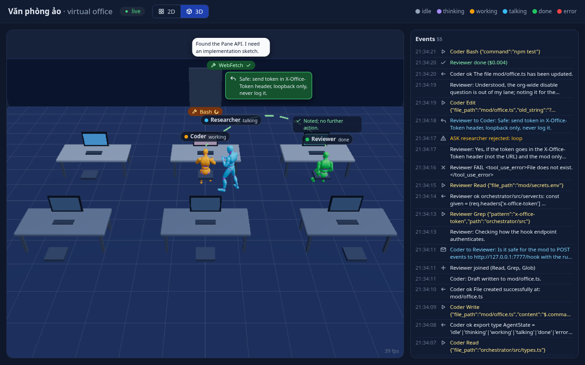
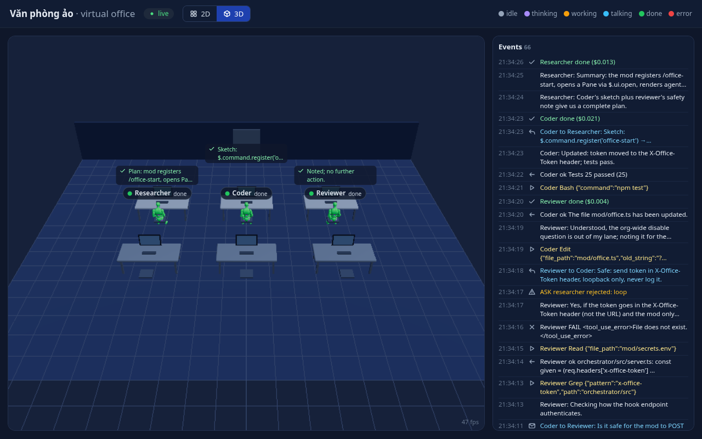
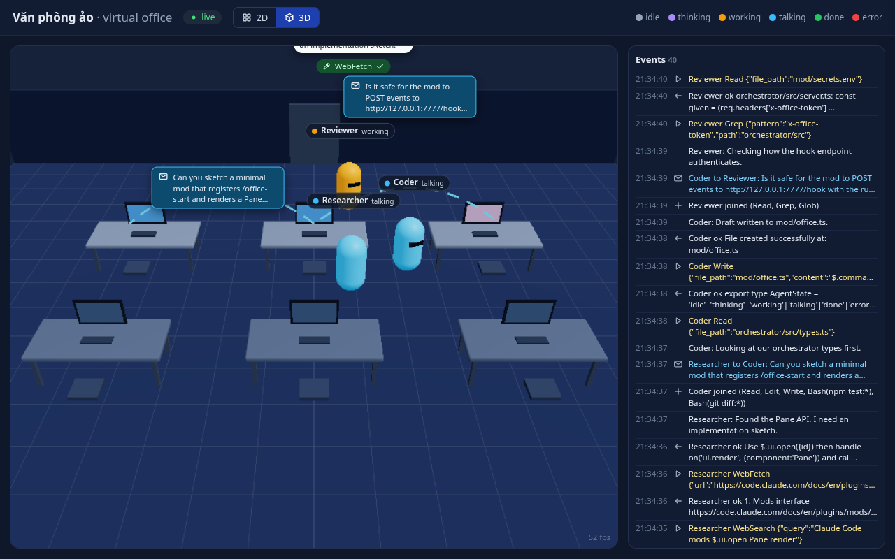

# Văn phòng ảo (virtual office)

A small local "office" where Claude Code agents (Researcher, Coder, Reviewer) work at desks. When one agent asks another a
question, it walks over to that agent's desk and waits there until the reply comes back. You can watch the run in a 2D or
3D browser view. Design: [docs/ARCHITECTURE.md](docs/ARCHITECTURE.md).



Full video: [docs/screens/phase4-mock-run.mp4](docs/screens/phase4-mock-run.mp4)

## Setup

Requirements: Node 20+. Running real agents also needs the `claude` CLI, logged in.

```sh
(cd orchestrator && npm install)
(cd web && npm install && npm run build)   # the orchestrator serves web/dist
```

## Run

Mock run. This needs no API calls; the agents replay the recorded fixtures in `orchestrator/fixtures/office/`:

```sh
orchestrator/node_modules/.bin/tsx orchestrator/src/cli.ts start --mock --office --keep-alive "Plan a Claude Code mod"
```

Real run. This starts `claude -p --output-format stream-json` with the allowlisted tools for each role and
`--permission-mode default`. It never uses `--dangerously-skip-permissions`:

```sh
orchestrator/node_modules/.bin/tsx orchestrator/src/cli.ts start --office --keep-alive "your task"
```

From inside Claude Code you can run `/office-start <task>` instead (set `OFFICE_MOCK=1` for the mock driver).

Open the UI by copying the URL from `orchestrator/.run/ui-url.txt` (mode 600) into your browser. The URL carries the per-run
token in its fragment, and that token is never printed or logged. Useful flags: `--port`, `--mock-delay <ms>`,
`--start-delay <ms>`, and `--role`.

## Tests

```sh
(cd orchestrator && npm test && npm run typecheck)
(cd web && npm test && npm run typecheck)
(cd web && npm run screens4)   # headless Chrome (SwiftShader): phase-4 screenshots, video, fallback check, fps
```

## Screens

| | |
|---|---|
|  Working at desks |  Walking to a colleague |
|  Waiting while the question is in flight |  Reply, walk back |
|  Done, zoomed out |  Capsule fallback (model missing) |

The 2D view is shown in `docs/screens/phase3-2d-*.png`.

## 3D characters and attribution

The characters are the mannequin from **Universal Animation Library** by **Quaternius**
(<https://quaternius.com/packs/universalanimationlibrary.html>, downloaded from <https://quaternius.itch.io/universal-animation-library>,
file "Universal Animation Library[Standard].zip"). The pack's License.txt places it under **CC0 1.0 Universal** (public domain). A copy
is at [web/public/models/LICENSE-Quaternius.txt](web/public/models/LICENSE-Quaternius.txt). Thanks to Quaternius
(<https://www.patreon.com/quaternius>).

`web/public/models/office-character.glb` is `Unreal-Godot/UAL1_Standard.glb` from that zip, pruned to 5 clips (Idle_Loop,
Idle_Talking_Loop, Sitting_Idle_Loop, Sitting_Talking_Loop and Walk_Loop) and quantized with `web/scripts/prune-model.mjs`
(@gltf-transform). That takes it from 7.6 MB to 0.6 MB (263 kB gzip). The model loads only when you open the 3D view. If it
fails to load, each avatar falls back to a capsule.

To add or swap a model: put a CC0 skinned GLB in `web/public/models/` that has clips with the names above, then point `modelUrl()` in
`web/src/Character.tsx` at it. For testing, `?model=<file>.glb` in the URL overrides the file name. Only use CC0 assets.

## Known issues

- Message arcs are drawn desk-to-desk (seat to seat), not from the walking agent's current position, so while an agent is
  visiting a colleague the arc still starts at its empty seat.
- The sitting pose hovers slightly above the simple box chair; the chair and seat height are not fitted to the animation.
